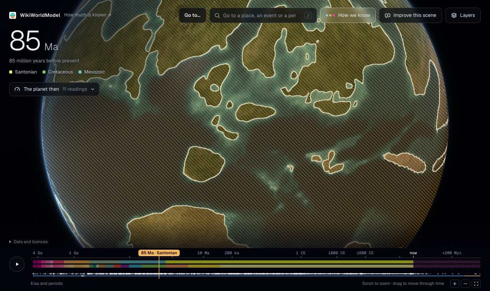
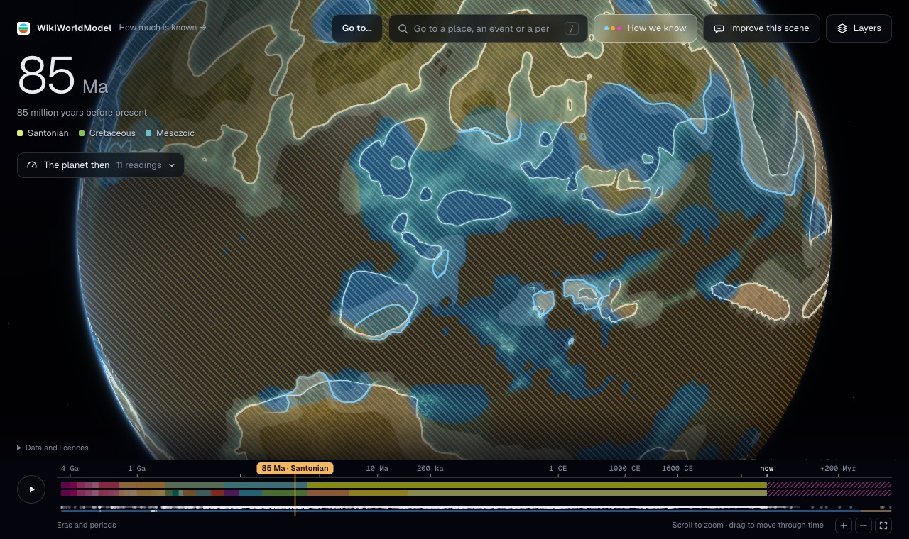
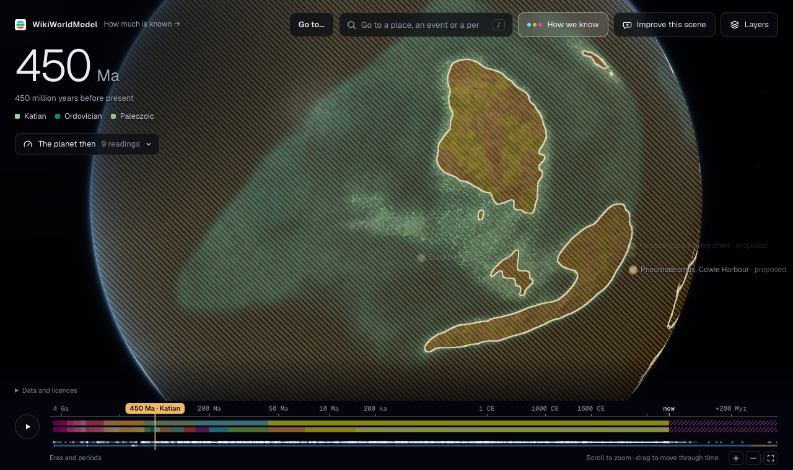
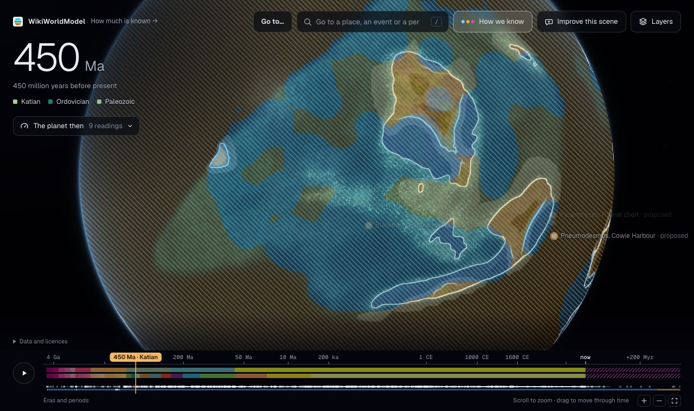

# Twenty-first slice: how likely the sea was, from the map and the rocks

Status: built; see *How it was checked* for what was and was not run. It is the first step of the Earth's track of
[plans/MODELS.md](../plans/MODELS.md#after-the-pilot), *the coast conditioned on the rocks*, and the first field over
the globe made as that plan asks: a prior from its cause, the evidence as what it observes, and scores on evidence held
out by place, by region and by era, set beside a smoother that knows no causes.

The land and sea of the deep past were one map for each five million years, drawn by hand, with no spread
(`field:earth/elevation`). The world's own rocks contradicted it and corrected nothing. Of the fossil localities in
beds laid down under the sea, 45% lie on that map's land at the keyframe they belong to. This slice makes of the map
and the localities a chance of sea, at every node of the map's grid and every keyframe, and says how well that chance
predicts localities it was not shown. It moves no ground: the elevation, the coast drawn and everything that stands on
them are as they were.

It adds:

- **The chance of sea** (`field:earth/sea-chance`, `model:earth/sea-chance`, [core/coast.ts](../../core/coast.ts)).
  At each of the elevation's 109 keyframes, on its 1° grid:
  - *Before any rock is read*, the map's, read softly: an even chance at the map's own coast, the log of the odds
    falling by a slope with each degree inland and rising by another offshore, to a cap, and at the cap over the
    ocean's floor.
  - *Then the localities of the keyframe's span.* A locality is every collection of the Paleobiology Database of one
    kind, marine or terrestrial, in a box of a tenth of a degree, counted once, where its plate stood at the keyframe.
    It counts whole at its own place and less with distance, on a bell 150 km wide. Over the ocean's floor it counts
    at its own node and at no other: an island says nothing of the ocean round it.
  - *Finds are not read as they come,* since the sea leaves far more of them than the land. The model reckons the
    share of marine among what a place yields. Before any find that is what the map's chance would yield, by how many
    times more a moment of sea leaves than a moment of land (the keyframe's *yield*). The finds near are averaged in
    with it, the map's expectation counting for a fraction of one locality, and the share is turned back into a chance
    by the same yield. A place where marine and land localities are found in the yield's proportion is as likely sea
    as land.
  - *Before the land had life* it left next to no localities, and no yield can be told. The 23 keyframes from 430 Ma
    back take the yield of the nearest keyframe whose rocks can tell one.
- **What was found near** (`field:earth/rock-finds`): the marine and the land localities near each node, each counted
  by how near it lies, in the same files. It is a first measure of where people have looked, kind by kind. It is not
  yet the model of effort that [decision 14](../plans/MODELS.md#14-evidence-has-a-model-of-how-it-came-to-exist) asks
  for: it counts what was found of two kinds, not every collection whatever it found.
- **The fit, in the build** ([tools/world/src/build/coast.ts](../../tools/world/src/build/coast.ts)). The two slopes
  and each keyframe's yield are those with which the kind of every locality is best told from its distance to the
  map's coast and nothing else. How many localities the map counts for, and the width of the bell, are those that best
  predict a locality without the others of its node and of its tile. The build writes what it fitted into
  `coast/index.json`; the records hold no fitted number.
- **Scores on localities held out**, four ways: with the others of its own node left out, with its tile of 5°, with
  its block of 20° (a region), and with every fourth keyframe whole (an era: its localities are told from the map
  alone, with a yield taken from the keyframes either side). Each is set beside the same localities with no map (an
  even chance everywhere before them), the map read softly with no finds, and the map's coast taken as sure. They are
  in `coverage.json` under `coast`, on the coverage page, and printed by `npm run world -- coast`.
- **Two checks it does not read:** the columns of rock (`field:earth/strata`), whose units were laid down under the sea
  or on land at each keyframe where a column stands; and the present, where the coast is measured and the model does
  not know it.
- **Members of the world** ([core/coast.ts](../../core/coast.ts), `memberLevel`; [core/samples.ts](../../core/samples.ts)).
  A member is a level of the chance: its sea is wherever the chance is above its level, the median member's at a half.
  So a member's coast is one line, the members' seas lie one inside another, and the ground that is sea in some and
  land in others is the coast's band.
- **How a model's record says it is made** ([RECORDS.md](../RECORDS.md#a-model)): its `kind`, its `prior` from each
  cause, what it `observes` with each observation's support, error and effort, and what it is held to (`holdout`). The
  schema has them, the validator checks their references, and
  [sea-chance.yaml](../../world/models/earth/sea-chance.yaml) is the first record to use them.
- **The geography's evidence tier** ([core/resolve.ts](../../core/resolve.ts)). Where the finds near outweigh the map,
  land and sea answer as evidence, with why; elsewhere as a model, as before. The coverage page has it as a lane of
  the layer *Land and sea*.
- **In the viewer.** In evidence mode the ground where the finds outweigh the map is hatched in the blue of evidence
  where all of the map was amber; the band where between a quarter and three quarters of the members have sea is
  washed pale; the model's own coast is traced in blue where localities lie near; and where the model's likelier side
  is not the map's, the ground is drawn as the rocks have it. A click on the ground says how likely the sea was, what
  was found near, and which says more.

## Running it

```sh
npm run build:world                       # fits the model, writes coast/ and its scores (about 30 s of the build)
npm run world -- coast                    # how it held on what it did not see
npm run world -- coast 38.9 -100.5 "85 Ma"   # a place of today at a time: Kansas, under the Western Interior Seaway
npm run dev                               # http://localhost:5173/?t=85Ma&lat=38&lon=8&d=2.35&cl=0&ev=1
```

## Pass criteria

Each with what the build of this slice found. Four do not hold in full, and say why.

| Criterion | Where it is checked | Found |
|---|---|---|
| There is a chance of sea at every node of every keyframe of the elevation field, and it is the map's own where nothing was found near | `core/coast.test.ts`: *leaves a place with no find near at the field's chance…*; `tools/world/test/coast.test.ts`: *gives a chance of sea at every node of every keyframe…* | Holds: 109 keyframes of 65,160 nodes, from 164,489 localities of 278,985 collections. With nothing near, the chance stays between 1.8% and 98.2%, the cap. |
| Localities held out lie on the side their kind is of more often than against the map's coast | `tools/world/test/coast.test.ts`: *puts localities held out on the side their kind is of…* | Holds. Marine localities in the sea: 55% by the map's coast; 84% by the model with the others of their node held out, 78% with their tile, 64% with their block. Land localities on land: 87% by the map; 88%, 86% and 85%. |
| It beats the smoother with no causes on localities held out, and by more the more is held out | `tools/world/test/coast.test.ts`: *beats the smoother with no causes where a tile, a region or an era is held out…* | **Holds but at a node.** The mean log of the chance given to the kind a locality was (0 is sure and right, −0.69 a coin): −0.331 against −0.345 with a tile held out, −0.400 against −0.468 with a block, −0.422 against −0.527 with a keyframe. With only its own node held out it is −0.269 against the smoother's −0.265: at the range of the finds' own bell a smoother does as well, and over the ocean's floor better, since it lets an island's localities speak for the next island. The map read softly with no finds, −0.436; the map's coast as sure, −1.073, worse than a coin. |
| Its chances mean what they say: of the localities given a chance of being marine, about that share were | `tools/world/test/coast.test.ts`: *says what it means…* | Holds within 0.05 with a node, a tile or a block held out. **Does not hold with a keyframe held out whole:** of those given 9%, 18% were marine, and of those given 53%, 61%. A keyframe's yield borrowed from its neighbours is not its own. |
| It agrees with the columns of rock, which it does not read, more often than the map's coast does | `tools/world/test/coast.test.ts`: *agrees with the columns of rock…*, *says how it does through time…* | Holds for both kinds together: 81% of 28,504 units lie on the model's likelier side, 72% on the map's; of units laid down under the sea, 83% against 69%. **Does not hold for units laid down on land:** 74% against the map's 79%. The model reads finds and nothing of their absence, and moves the coast towards the sea (`disagrees`, in its record). |
| Held to the present, where the coast is measured, it leaves the coast where it is | `tools/world/test/coast.test.ts`: *held to the present…* | **Does not hold.** At the youngest keyframe the model has 4.2% of the globe likelier sea that is land, and 2.7% likelier land that is sea, most of both within two degrees of the coast. Its localities there are of the last 2.5 Myr, in which the sea stood up to some 120 m lower and at times higher, so part of that is the span's; the rest is how far the model's coast can be trusted at any time. Before the ocean floor's rule it turned 6.9% of the globe from sea to land there, two thirds of it deep ocean about islands. |
| A marine and a land locality count by what the sea and the land leave: found in the yield's proportion, a place is as likely sea as land | `core/coast.test.ts`: *takes a place where marine and land localities are found in the yield's proportion…*, *moves towards the sea with marine localities…*; `tools/world/test/coast.test.ts`: *fits a yield for each keyframe since the land had life…* | Holds. The fitted yields: 1.6 to 2 marine localities for one of the land's in the last 10 Myr, 3 to 7 from there back to 150 Ma, and 5 to 25 back to 425 Ma. The keyframes before take the 17 of 425 Ma. |
| Over the ocean's floor a locality counts at its own node and at no other | `core/coast.test.ts`: *counts a locality over the ocean's floor at its own node and at no other…* | Holds. |
| A member's sea is one sea inside another's, the median member's where the chance is above a half | `core/coast.test.ts`: *draws a member's sea wherever the chance is above its level…* | Holds, for sixteen members. |
| The geography answers in the evidence tier where the finds outweigh the map, and only on the elevation of the deep past | `core/resolve.test.ts`: *answers land and sea as evidence where the rocks of the time say more than the map…*; `tools/world/test/coast.test.ts`: *answers the geography in the evidence tier…*; `tools/world/test/build.test.ts`: *answers every layer everywhere in a tier…*, *charts every layer…* | Holds: 6% at 500 Ma, 9% at 250 Ma, 11% at 100 Ma and 16% at 5 Ma of the coverage chart's places. From 798 ka on, today's relief is the map, and the chance says nothing. |
| The globe holds what the files say, at a keyframe and carried on its plate between two | `viewer/test/e2e/coast.spec.ts`: *the globe holds what the files say…* | Holds: every sixth degree at 85 Ma reads the file's own bytes, and at 82.6 Ma nodes that have moved are read where they stand. |
| In evidence mode the ground the rocks speak for turns blue and the rest stays amber; a click says the chance, what was found near and which says more | `viewer/test/e2e/coast.spec.ts`: *in evidence mode…*, *a click says…*, *the geography answers in the evidence tier…*; `viewer/test/e2e/coverage.spec.ts`: *shows how the sea's chance held…* | Holds. A click fetches the one keyframe it needs. |
| The model's record says its prior, what it observes and what it is held to, and names tests that hold it to each | `npm run validate`; `world/models/earth/sea-chance.yaml` | Holds: no errors, no warnings; ten checks named, each found by the validator. |
| The fit and every score add under a minute to a full build | the build's log | Holds: about half a minute, of which the three widths of the bell tried take most. |

## What it finds

Over all keyframes the localities outweigh the map on 7.1% of the globe, 2.7% of the globe changes
side, and 79% of that becomes sea. 26% has a chance of sea between 5% and 95%.

Through time, with each locality's own node held out, and the columns of rock, which the model does not read: the
share on the side their kind is of, by the map's coast and by the model.

| Keyframes | Marine localities in the sea | Land localities on land | Units laid down under the sea | Units laid down on land | Both kinds of unit |
|---|---|---|---|---|---|
| 95–0 Ma | 41% → 78% of 23,150 | 88% → 87% of 14,153 | 55% → 84% of 5,706 | 87% → 78% of 2,756 | 66% → 82% |
| 195–100 Ma | 43% → 82% of 11,997 | 91% → 90% of 3,587 | 38% → 63% of 3,148 | 85% → 78% of 1,360 | 52% → 67% |
| 295–200 Ma | 50% → 86% of 13,120 | 85% → 94% of 3,040 | 56% → 70% of 2,501 | 77% → 74% of 1,136 | 63% → 72% |
| 395–300 Ma | 74% → 77% of 7,644 | 77% → 86% of 1,100 | 86% → 86% of 4,489 | 47% → 56% of 605 | 82% → 83% |
| 425–400 Ma | 79% → 88% of 2,297 | 59% → 83% of 149 | 84% → 84% of 1,218 | 48% → 53% of 109 | 81% → 81% |
| 540–430 Ma, before the land had life | 82% → 98% of 11,058 | 7% → 29% of 14 | 92% → 97% of 5,224 | 72% → 66% of 252 | 91% → 95% |

- **The map is at its worst where the record is best.** Of the marine localities of the last 200 Myr, fewer than
  half lie in the map's sea. Beds of an old sea are collected where they lie on today's land, which is where a sea has
  since withdrawn: the localities sample the edges of the old seas, and the edges are where the map is least sure.
- **The model gains most there,** and against the columns too: of their units laid down under the sea in the last
  100 Myr, 55% lie in the map's sea and 84% in the model's.
- **It loses on the land's units in every stretch since 300 Ma,** by three to nine in a hundred. Where it moves the
  coast, it moves it towards the sea.
- **Before 300 Ma it changes little of the sea's units that the columns can see:** the map already has most of them
  in its sea. There it gains on the land's units instead, 47% to 56%, where the map has a sea the rocks do not.
  Before the land had life the model puts 97% of the sea's units in its sea, against the map's 92%.

A few places, asked of the build (`npm run world -- coast <lat> <lon> <time>`), the place given as it is today:

| Place, as it is today | Keyframe | The map has | Marine localities near | Land | Chance of sea |
|---|---|---|---|---|---|
| Kansas (38.9°N, 100.5°W) | 85 Ma | sea | 46 | 1.6 | 87% |
| Paris (48.86°N, 2.35°E) | 85 Ma | sea | 26 | none | over 99% |
| Solnhofen, Bavaria (48.9°N, 11°E) | 150 Ma | land | 53 | 1.3 | 86% |
| London (51.5°N, 0.1°W) | 50 Ma | sea | 46 | 6.0 | 59% |
| Cairo (30°N, 31.2°E) | 40 Ma | land | 22 | 0.1 | 96% |
| Hell Creek, Montana (47.5°N, 106.9°W) | 65 Ma | land | 3.6 | 60 | 1% |
| Moab, Utah (38.6°N, 109.5°W) | 150 Ma | land | 0.4 | 28 | 0% |
| Beaufort West, the Karoo (32.35°S, 22.6°E) | 255 Ma | land | none | 46 | 0% |
| Cincinnati (39.1°N, 84.5°W) | 450 Ma | sea | 127 | none | over 99% |
| Field, British Columbia (51.4°N, 116.5°W) | 505 Ma | sea | 11 | none | 93% |

## What it looks like

Evidence mode over Europe and the Tethys at 85 Ma, and over Laurentia at 450 Ma, as before this slice and with it, in
the same views on the GPU, against the same build. Before, all of the map is hatched amber: a reconstruction. With it:

- the ground where localities lie near is hatched in the blue of evidence;
- a pale band runs along every coast, where between a quarter and three quarters of the members have sea, wider
  where nothing was found;
- the model's own coast is traced in blue beside the map's white one;
- and where the model's likelier side is not the map's, the ground is drawn as the rocks have it. At 85 Ma the islands
  the map draws over Europe are sea, where the chalk was laid down. At 450 Ma most of Laurentia is.

| | Before | After |
|---|---|---|
| 85 Ma |  |  |
| 450 Ma |  |  |

Outside evidence mode both viewers draw the same globe.

## Decisions

- **A share of what is found, not a presence.** A model that took any marine locality near as a sign of sea flooded
  every place where the sea came and went: on ground where both kinds are found, most of what is found is marine,
  since the sea leaves more. Held against the columns of rock, that model put 70% of the land's units on its land
  where the map puts 79%. Reckoning the share of marine among the finds, and turning it back by the yield, puts 74%.
- **The yield is fixed by taking the map's coast to be right on average.** More sea, and sea beds better kept, leave
  the same record: finds alone cannot tell them apart. So the model can move the coast from place to place, and cannot
  say that a whole keyframe had more sea than its map. That is the sea level's to say, which this model does not read.
- **Before the land had life the yield is held, and the model is neither fitted nor scored there.** Every locality of
  those keyframes is marine whatever the ground was, so a kind fits nothing and tests nothing. Fitted there, a yield
  ran to the thousands, and a few hundredths of a land locality far off then outweighed ten marine ones at the place:
  the ground of the Burgess Shale read 13% for the sea. With the yield of the nearest keyframe that can tell one, the
  model agrees with the columns' units of those keyframes 95 times in a hundred, where it had 92 and the map 91.
- **Over the ocean's floor a locality speaks for its own node only.** The fossil record does not sample the seas that
  are still sea, so the land sites of islands and of coasts have nothing set against them there. Read as other
  localities are, those of the Quaternary turned 4.5% of the globe from deep ocean to land at the present. The rule
  costs the model its lead over the smoother at a node, since the smoother lets one island's localities speak for the
  next. It is kept because the present can check it, and the present says the ocean round an island is ocean.
- **Nothing is made of what was not found.** A place with no locality near keeps the map's chance however long anyone
  has looked there. Reading absence needs to know where people looked and what would have been kept
  ([decision 14](../plans/MODELS.md#14-evidence-has-a-model-of-how-it-came-to-exist)), which the world does not have
  yet.
- **Localities, not collections.** A quarry collected a hundred times says no more of the sea than one collected
  once. Collections of one kind within a tenth of a degree are one locality; a collection is of each keyframe its age
  overlaps, by the share of its span that lies inside.
- **Fitted in two steps.** Fitted together with the finds, the slopes took up what the finds explain and the map read
  alone no longer meant what it said. So the slopes and yields are fitted to the map alone first, and the map's weight
  and the bell after, each on localities held out.
- **The ocean's floor is at the cap.** The localities found far offshore are of islands and of ground the plates have
  since carried elsewhere. Read as they come they made the offshore slope so shallow that two thirds of the globe had
  a chance between 5% and 95%. Deeper than 1,000 m the map's sea is as sure as the map can say.
- **A second bell was tried and left out:** a locality counting for less at a node the map places differently from
  its own. It gained 0.001 on localities held out, and did not stop the islands' leak, since an island smaller than a
  node is on a node the map calls ocean.
- **A member is a level, one for the whole globe.** It makes a member's coast a single line and the members' seas
  nested, which a drawing and a count both need. It takes every stretch of coast to err the same way, which is the
  simplest thing that could be so and is not likely.
- **Evidence where the finds outweigh the map.** The geography answers as evidence where the finds near weigh at
  least as much as the map's expectation does, a quarter of one locality as fitted. The elevation in metres there is
  still the map's, and the panel says so.
- **The coast drawn is still the map's.** The rivers, the climate, the biomes and the scenes stand on the elevation,
  and a coast that moved without them would contradict them. Evidence mode draws what the rocks say over it.
- **A model's record holds no fitted number.** Each fitted parameter is a `choice` that says where the fit starts and
  where the build writes what it fitted: a fitted value is derived ([rule 5](../../CONTRIBUTING.md#the-rules)).
- **Outside evidence mode the globe is as it was,** so no golden image changes.

## Limitations

- **It knows no cause of the sea.** No sea level, no sinking basin, no mantle's push. A keyframe's sea is not told
  from the next keyframe's: each is fitted alone, but for the yield shared with two neighbours either side.
- **Its coast is good to a few degrees and no better.** Held to the present it moves about 7% of the globe across a
  coast that is measured. The bell is 150 km wide, the grid a degree, and a locality's bed may be of any time in five
  million years.
- **It reads no absence,** so where it moves the coast it moves it towards the sea, in four fifths of the ground
  that changes side, and it is right about the land's units of the columns less often than the map is.
- **How much a place was looked at does not cancel everywhere.** Marine against land cancels it where both kinds
  could be collected. Old seas that are still sea have no localities of either kind, and the model says only what the
  map says of them.
- **The elevation is unchanged.** A place the model takes for sea still has the map's height, and the climate, the
  rivers, the life atlas and every scene read the map's coast. The model corrects nothing downstream yet.
- **The map is read as softly at every keyframe.** The slopes and the map's weight are one fit for 425 Myr. The map
  of the present is measured, and the model does not know it.
- **A keyframe held out whole is not well told** (above): the yield changes faster than two keyframes either side
  can say.
- **Before the land had life the model is applied, not tested.** Only the columns of rock check it there.
- **Only the database's two kinds.** A collection it calls both marine and terrestrial, or neither, is not counted. A
  bed's rock is not read: a coal, a salt, a reef say more than "terrestrial" and "marine" do.
- **The columns of rock are a check and not yet an observation.** They are the one evidence here that records a gap,
  ground where nothing was laid down, which is the nearest thing to an absence the world holds.
- **Places are as good as the plate model.** A locality stands where PALEOMAP puts its plate at the keyframe; the bell
  takes up some of that, and the width is one for all time.
- **The build's own answer reads the keyframe nearest a time at the place asked,** without carrying the place on its
  plate between keyframes, as the viewer does. In 2.5 Myr a plate moves a few tenths of a degree.
- **The scoring is this model's own,** in its build stage. There is no shared harness for a field's hold-outs yet:
  the second field made so should make one of this.
- **Between keyframes the globe blends two chances,** as it blends two elevations. No one reconstructed those years.

## How it was checked

By the agent that built it (Claude Code), on one machine, on 27 November 2026:

- `npm run typecheck`;
- `npm test`, 1,175 tests passing;
- `npm run validate`, no errors and no warnings;
- a world build from the working tree, not a clean commit (`a75d53761a4f33eb`), and `npm run test:build` on it, 138 tests
  passing;
- `npm run build:viewer`, and the browser tests in software, as CI draws them, on a port of their own. All three
  groups ran against the build before the last changes of wording: the globe's 117 tests, the city's 50 and the six
  city views. One failed, an older test of a click on the ground that looked for the panel's one badge and found the
  new section's too; it was corrected. No golden image changed. After the last changes, to the panel's headline and to
  the field's description, the globe group's tests of this slice, of the coverage page, of the viewer and of the ice
  were run again on the final build, 53 tests passing;
- `npm run causes`: the graph of causes checked, and its page rebuilt;
- views of evidence mode at 85, 150 and 450 Ma on the GPU, beside the same views of the viewer as it was before this
  slice, against the same build; the panel of a click, and the coverage page's section;
- the model asked about ten well-known places, its scores set out by stretch of time, and the model held to the
  present. That is how two faults of its first form were found, which its scores on localities held out had not
  shown: the islands' land sites turning the ocean round them to land, and a yield fitted where the land left no
  localities ([Decisions](#decisions)).

Three figures here are not in the build's files. They were worked out for this document with a script, from the build
stage's own output: how far from the coast the ground lies that changes side at the present; what the model did at
the present before the ocean floor's rule; and how it agreed with the columns' units before the yield was held.

No source was read and no claim was written. The slice adds two fields and a model, which read datasets the world
already had, so no quote was checked.

## Next

On the Earth's track of [plans/MODELS.md](../plans/MODELS.md#after-the-pilot):

- **The columns of rock as an observation,** with their gaps read as the absence they are, and a bed's rock read for
  more than its two kinds.
- **The sea's level as a cause.** The prior from the map's height above its own sea in place of the distance to its
  coast, with a level for each keyframe fitted to the finds: then a keyframe can have more sea than its map, and the
  model says by how much.
- **The map's own sureness by its age,** anchored on the present, where the coast is measured: the youngest maps read
  less softly than the oldest.
- **The elevation conditioned, and the coast moved:** the height of a place the rocks say was sea brought below the
  sea, and the eight ranges' measured heights read as observations, so that what stands on the ground stands on the
  corrected ground.
- **The effort behind the fossils,** as a field: every collection of a span within reach, whatever it found, for the
  life atlases to read their absences over, and for this model to tell an unsampled sea from an empty one.
- **A shared harness** for a field's hold-outs by tile, block and era, with its cause-free baseline.
