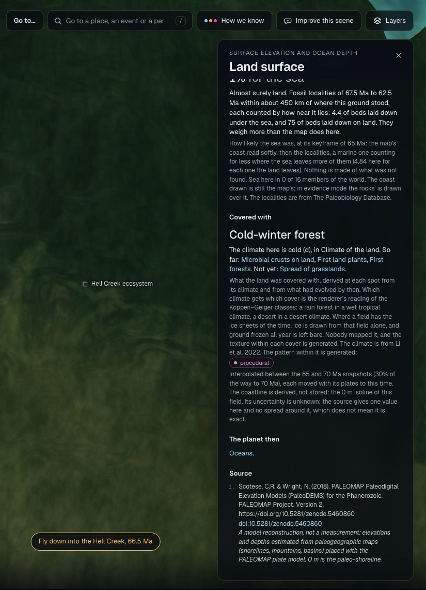
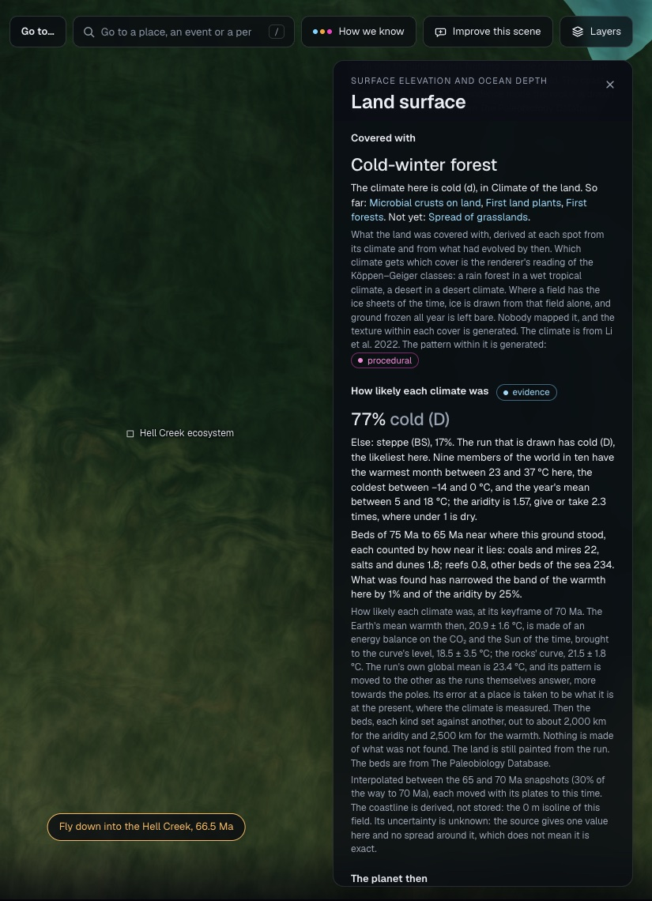

# Twenty-fourth slice: the climate of the deep past, conditioned on its evidence

Status: built; see *How it was checked* for what was and was not run. It is the last step named on the Earth's track
of [plans/MODELS.md](../plans/MODELS.md#after-the-pilot), *the climate as an ensemble conditioned on its proxies*,
begun for the deep past's runs and the evidence the world already held. It follows the form of the
[twenty-first slice](TWENTY-FIRST-SLICE.md): a prior from causes, the evidence as what it observes, and scores on
evidence held out beside a smoother that knows no causes. The pass criteria below were written before the model, and
the ones that fail are kept.

The climate that every biome, river and scene of deep time reads is one run of another's model for each ten million
years (`field:earth/climate`, Li et al. 2022), with nothing to say how sure it is, and no evidence of the world
conditioned it. This slice makes, beside each run, a climate with a spread at every node, and says how well it
predicts evidence it was not shown. It moves nothing that is drawn: the land is painted from the run, and the water,
the rivers, the atlases and the scenes read the run, as they did.

It adds:

- **The Earth's mean warmth at each keyframe** ([core/climatechance.ts](../../core/climatechance.ts), `Warmth`).
  - *Before any evidence*, what the energy balance (`model:earth/energy-balance`) makes of the Sun and the CO₂ of the
    time, once for each of the sixteen members of the CO₂, brought to the level of the rocks' curve, with the
    balance's own error about it. The world has no CO₂ before 420 Ma, and the twelve keyframes before it have no
    prior.
  - *The rocks' curve observes it* (`field:earth/surface-temperature`): the mean of its values over the keyframe's
    span of ten million years, with its band and with how far it moves within the span.
  - *So do the fossil forests of the span.* Trees grew where a forest stands, so its warmest month was no polar one:
    each value of the Earth's mean warmth is weighed by how likely trees were at the forest's place under it. A
    forest near a pole asks for a warm Earth. This is evidence of one place fitting what every place reads
    ([decision 16](../plans/MODELS.md#16-evidence-does-two-jobs-and-flows-down-the-graph)).
  - *A member keeps its place.* A member drawn with more CO₂ stays the warmer after the evidence, so member 7 of
    the climate goes with member 7 of the CO₂.
- **How the pattern answers to the mean.** A run is a pattern about its own global mean, and each run was tuned to a
  mean (below). Across the 55 runs, for each degree of the Earth's mean warmth the land warms by 0.9 °C in the belt
  of the equator and by 2.8 °C at the poles, more with each belt of ten degrees between, and the land of the middle
  latitudes is a little drier. A member's climate at a place is the run's there, moved by its own mean warmth so.
- **The run's own error, read where it can be measured.** The run of the present is held to the climate measured
  (`field:earth/climate-late-quaternary`, whose youngest keyframe was corrected to the climate observed in 1901 to
  1930). Over 4,073 land nodes it is out by 2.5 °C in the year's mean, by 2.2 °C in the season's swing (half the
  warmest month less the coldest) and by a factor of two in the aridity, as root mean squares; and its errors go
  together over about 1,200 km for the warmth and 900 km for the aridity. That is taken for its error at every time.
- **Beds that tell of climate, found near** (`field:earth/climate-beds`): at each node and keyframe, the Paleobiology
  Database's collections of each kind, gathered into beds a tenth of a degree across and placed where their plates
  stood, in three pairs. Coals and mires against salts and dunes; reefs against the other beds of the sea; tills
  against the other beds of the land. 116,575 beds of 278,985 collections.
- **What the beds make of the climate.** Each kind is set against another, so that how much a place was dug does not
  enter: what is reckoned is the share of the one kind among the two found near.
  - The members expect a share from the climate they give the place, by a link fitted over all time: the log of the
    odds of a coal among coals and salts rises with the log of the aridity, of a reef with the warmth of the sea's
    surface. Each keyframe has a level of its own, which takes the members to be right on average.
  - The beds near say how far the place's own share lies from that.
  - Of that distance the climate is given only its part: as much as the run's error, as measured at the present,
    could explain of what moves such shares at all. For coals and salts that is 45%; for reefs 3%; for tills 2%.
  - Nothing is made of what was not found.
- **The climate with its spread** (`field:earth/climate-chance`, `model:earth/climate-conditioned`): at every node
  of the climate field's 2° grid and each of its 55 keyframes, a central warmest month, coldest month and aridity, a
  spread about each, and the chance of each of the eight classes the globe paints the land by. It is written in
  files of its own, one a keyframe (`climate-chance/`).
- **Members of the world** ([core/samples.ts](../../core/samples.ts)). A member is four draws, the same at every
  place and time: of the Earth's mean warmth; of the run's error in the year's mean; of its error in the season's
  swing; and of its error in the aridity. The files keep the central climate and the spreads, so any member can be
  drawn.
- **The fit, in the build** ([tools/world/src/build/climatechance.ts](../../tools/world/src/build/climatechance.ts)).
  The pattern's answer, the run's error at the present and its reach, the balance's level and error, each link's
  slope, each keyframe's levels and how much a place's own share varies are all fitted in the build and written
  into `climate-chance/index.json`; the records hold no fitted number.
- **Scores on beds held out**, four ways: with the others of its own node left out, with its tile of 10°, with its
  block of 40° (a region), and with every fourth keyframe and the two either side whole (an era of fifty million
  years: its beds are told with nothing found and a level from the keyframes beyond). Each is set beside the same
  beds told by latitude and time alone, and beside the members with nothing found. They are in `coverage.json` under
  `climateChance`, on the coverage page, and printed by `npm run world -- climate`.
- **Checks it does not read:** the columns of rock (`field:earth/strata`), whose units with salt are ten times the
  fossil collections' beds of it; the present, by blocks; and the Hell Creek's leaves. Each fossil forest is told
  with itself held out.
- **What a model's record may observe** ([RECORDS.md](../RECORDS.md#a-model)): every claim of a property, written as
  an input is (`{ prop: evidence, kind: occurrence }`), besides a record. The forests are records and no field.
- **The climate's evidence tier** ([core/resolve.ts](../../core/resolve.ts)). Where what was found near has taken
  away a quarter or more of the square of the spread of the warmth or of the aridity, the climate answers as
  evidence, with why; elsewhere as a model, as before. The coverage page has it as a lane of the layer *Climate*.
- **In the viewer.** A click on the land of the deep past says, under what covers it, how likely each climate was,
  the band nine members in ten have for the warmest and the coldest month, what was found near, and what the Earth's
  mean warmth of the time was made of. The globe draws nothing new.

## What the runs were made at

The dataset's paper says how each run's level was set (Li et al. 2022, *Methods*, read from Europe PMC's full text):

- **Each run was tuned to a temperature, not to a CO₂.** "For simulations from 540 Ma to 10 Ma, CO₂ concentrations are
  tuned until simulated GMSTs are asymptotic to reconstructed GMSTs within ± 0.5 °C." The reconstruction is Scotese
  et al.'s, in an earlier form than the curve the world holds: over the span of each keyframe the runs' global means
  lie up to 7.7 °C above the world's curve (at 470 Ma) and 3.2 °C below it (at 170 Ma), 2.8 °C as a root mean
  square.
- **The CO₂ a run was given is not evidence of the CO₂.** The paper's Table 1 has 2.3 to 28 times the pre-industrial
  280 ppm, "several times higher than reconstructions", by its own account because of the model's sensitivity and
  its sparse vegetation.
- **The Sun** was taken to brighten evenly from 1,302 to 1,361 W m⁻², and the orbit held at today's.
- **The run of the present is made otherwise:** with today's vegetation and ice laid down, where the others grow
  their vegetation from bare ground and have no ice sheets. So the present says how far a run of this model can be
  out, and not what the deep past's runs are out by on average.

So a run's level is a choice of its makers', and its pattern is the model's answer to that level: which is what
lets the pattern's answer to the mean be read across the runs. The global means worked out here from the file, each
cell by its area, are the paper's Table 1 to a tenth of a degree.

## Running it

```sh
npm run build:world                              # fits the model, writes climate-chance/ and its scores (about 15 s of the build)
npm run world -- climate                         # how it held on what it did not see
npm run world -- climate 47.55 -106.86 66.5 Ma   # a place of today at a time: the Hell Creek
npm run dev                                      # http://localhost:5173/?t=66.5Ma&lat=53.8&lon=-80.6&d=1.6&cl=0, and click the land
```

## Pass criteria

Each with what the build of this slice found. Six do not hold in full, and say why.

| Criterion | Where it is checked | Found |
|---|---|---|
| There is a climate with its spread at every node of every keyframe of the climate field: a central warmest month, coldest month and aridity, a band about each, and a chance for each of the eight classes, which add to one. Where no bed lies near it is the run's, moved to the Earth's mean warmth and corrected as the present says | `core/climatechance.test.ts`: *gives the run's own class a chance of one where nothing is spread…*; `tools/world/test/climatechance.test.ts`: *gives a climate with its spread at every node the run has one…* | **Holds but for the correction.** 55 keyframes of 16,380 nodes, a climate wherever the run has one. The run's mean error at the present is not taken off: it is part of the spread ([Decisions](#decisions)). |
| Member 0 is the central value, and a member's warmth goes with its CO₂: a member drawn with more CO₂ is no colder | `core/climatechance.test.ts`: *keeps member 0 the central climate…* | Holds, for sixteen members at each keyframe. |
| The pattern answers to the Earth's mean warmth as the runs themselves do: more towards the poles than at the equator | `core/climatechance.test.ts`: *moves the run's pattern more towards the poles…*; `tools/world/test/climatechance.test.ts`: *reads from the runs that the poles answer…* | Holds: 0.91, 0.97, 1.15, 1.19, 1.45, 1.81, 2.29, 2.71 and 2.82 °C on the land of each belt of ten degrees from the equator, for each degree of the mean. |
| With an era of the rocks' curve held out, the energy balance on the CO₂ of the time tells its values better than the mean of the other eras does | `tools/world/test/climatechance.test.ts`: *tells an era of the rocks' curve held out better than the mean of the other eras once brought to its level, and worse as it is* | **Does not hold as written.** As it is, the balance tells the curve to 5.9 °C (root mean square over 43 keyframes), and the mean of the other eras to 3.7: it is 4.9 °C colder than the curve on average. Brought to the curve's level by the other eras, it tells it to 3.4, which is how the model uses it. |
| A bed moves the estimate the way its kind says: a coal towards wet, a salt towards dry, a reef towards warm, a till towards cold. Beds found in the proportion the members expect leave it where it was | `core/climatechance.test.ts`: *moves towards wet with coals and towards dry with salts…*, *gives the climate only its part…*, *reckons a place's own share…* | Holds. The fitted links run the way their kinds say. |
| Beds held out are told better than by the smoother that knows only latitude and time, and by more the more is held out: a node, a tile, a block, a keyframe | `tools/world/test/climatechance.test.ts`: *tells wet and dry beds held out better than the smoother with no causes, and reefs no better* | **Holds for coals and salts, but not for reefs, and not by more with an era.** A keyframe held out alone is told by the beds of the keyframes beside it, which lie in the same basins, so an era is held out in its place: the keyframe with the two either side. The mean log of the chance given to the kind a bed was (0 is sure and right, −0.69 a coin). Wet and dry beds: −0.334 against the smoother's −0.340 with a node held out, −0.378 against −0.393 with a tile, −0.446 against −0.497 with a block, −0.486 against −0.491 with an era. Reefs: −0.225, −0.236 and −0.250, the same as the smoother to three places, and −0.261 against its −0.260 with an era: the run's warmth tells where reefs lie no better than the latitude does. Tills: −0.158 against −0.191 with a block; they are of the youngest keyframes only, so no era of them can be held out. |
| Its chances mean what they say: of the beds given a chance of being of a kind, about that share were | `tools/world/test/climatechance.test.ts`: *says what it means…* | Holds within 0.13 for wet and dry beds and within 0.05 for reefs, with a node, a tile or a block held out. Its worst: of the wet and dry beds given 30% for wet with their node held out, 20% were. |
| It agrees with the columns of rock, which it does not read: their units with salt lie where the model has the land drier than their units with coal, and more clearly than by the run | `tools/world/test/climatechance.test.ts`: *orders the columns' units with salt and with coal…* | **Holds, by little.** Of 2,480 pairs of a unit with salt and one with coal at a keyframe, the salt lies on the drier ground in 89% by the model and 86% by the run. But only 48% of the 391 units with salt lie on ground whose central climate is arid, by the model as by the run (47%); 93% of the 447 with coal lie on ground that is not. |
| It gives the fossil forests, which it does not read, a climate that bears trees at least as often as the run does | `tools/world/test/climatechance.test.ts`: *gives the fossil forests, each held out, a climate that bears trees more often than not, and more once read* | **Does not hold, and the forests are now read.** The run's class bears trees at 14 of the 15 forests. Told with itself held out, a forest is given 84% for a climate that bears trees on average, from 47% at Rusinga to 99% at Joggins; once read, 88%. The forests were made observations because they are the strongest evidence of warmth the records hold. |
| At the Hell Creek the mean of the year that fossil leaves give, 12 to 20 °C, lies within the model's band | `tools/world/test/climatechance.test.ts`: *holds the Hell Creek's leaves against its band…* | **Does not hold in full.** The run has the year's mean there at 16.1 °C, inside the leaves' range. The model is colder, 11.6 °C, nine members in ten between 5.4 and 17.9: its band takes in the lower part of the leaves' range and not its middle. Its coldest month is above freezing in one member in seventeen, where crocodilians and palms say it did not freeze. The rocks' curve has the Earth of 75 to 65 Ma at 21.5 °C where the run was tuned to 23.4, and at the Hell Creek's latitude the land answers by 1.8 °C to the degree. |
| Held to the present, where the climate is measured, with each block's error told from the other blocks: the measured warmest and coldest month lie within the nine-in-ten band at about nine land nodes in ten, and the measured class is given more chance than the run's class taken as sure gives it | `tools/world/test/climatechance.test.ts`: *held to the present, has the measured climate in its band about nine times in ten…* | Holds. The warmest month at 90% of the land, the coldest at 91%, the aridity at 89%. The mean log of the chance given to the measured class: −0.738 by the run with its spread, −1.244 by the run's class as a point with the chance it turns out to deserve. |
| Held to the present, the beds of the youngest keyframe leave the climate where it is measured | the same test | Holds: they move it a little nearer. With the beds of the last five million years read and the warmth held at the run's, the measured class is given −0.727 where the run with its spread gives it −0.738; the likeliest class is the measured one on 70% of the land for the run's 68%; the log of the aridity lies 0.654 from the measured for 0.673; the coldest month 3.36 °C for 3.33. The tills of the ice ages are among those beds, and with the reefs take away a twentieth of the square of the warmth's spread at the most. |
| The climate answers in the evidence tier where the beds near say at least as much as the members do, and only within the deep past's field | `core/resolve.test.ts`: *answers the climate as evidence where what was found near has narrowed a run…*; `tools/world/test/climatechance.test.ts`: *answers the climate in the evidence tier only where…*; `tools/world/test/build.test.ts`: *answers every layer everywhere in a tier…* | **Does not hold as written: nowhere do the beds say as much as the members.** The most they take away is 45% of the square of the aridity's spread. The tier is given where they take a quarter or more, which narrows a band by an eighth: 4.7% of the land over all keyframes, and 15% over the last 90 Myr; of the coverage chart's places, 1% at 300 Ma, 2% at 150 Ma, 5% at 60 Ma and 17% at 5 Ma. Where the climate of the last glacial cycle answers, this says nothing. |
| A click says the chance of each class and what was found near; the coverage page has the scores; and nothing that was drawn changes | `viewer/test/e2e/climatechance.spec.ts`; the golden images | Checked on the build of this commit; what was found is filled in with the commit after it. |
| The model's record says its prior, what it observes and what it is held to, and names tests that hold it to each | `npm run validate`; `world/models/earth/climate-conditioned.yaml` | Holds: no errors, no warnings; fourteen checks named, each found by the validator. |
| The fit and every score add under a minute to a full build | the build's log | Holds: about 15 s. |

## What it finds

**The Earth's mean warmth.** At a few keyframes, in °C: what the causes make of it, what the curve says of the span,
the two with the forests, and the run's own.

| Keyframe | The energy balance, brought to the curve's level | The rocks' curve over the span | Together, with the forests | The run was tuned to |
|---|---|---|---|---|
| 0 Ma | 18.9 ± 3.4 | 14.7 ± 0.9 | 14.9 ± 0.9 | 14.3 |
| 50 Ma | 23.3 ± 3.4 | 24.3 ± 1.7 | 24.4 ± 1.4 (1 forest; 24.1 ± 1.5 before) | 22.6 |
| 70 Ma | 18.5 ± 3.5 | 21.5 ± 1.8 | 20.9 ± 1.6 | 23.4 |
| 90 Ma | 20.3 ± 3.6 | 27.0 ± 1.8 | 25.7 ± 1.6 (1 forest; 25.7 ± 1.6 before) | 24.2 |
| 250 Ma | 20.4 ± 3.9 | 27.1 ± 5.8 | 24.3 ± 2.4 (1 forest; 22.5 ± 3.2 before) | 25.8 |
| 300 Ma | 15.8 ± 3.6 | 12.8 ± 3.1 | 14.1 ± 2.4 (1 forest; 14.1 ± 2.4 before) | 15.8 |
| 380 Ma | 21.1 ± 4.0 | 20.9 ± 3.2 | 21.0 ± 2.5 (1 forest; 21.0 ± 2.5 before) | 25.1 |
| 470 Ma | – | 18.8 ± 3.7 | 18.8 ± 3.7 | 26.5 |

- **The runs' levels are not the curve's.** The world's curve is a later one than the runs were tuned to. Over the
  55 keyframes the model's central warmth lies between 7.7 °C below the run's own (at 470 Ma) and 3.5 °C above it
  (at 290 Ma), and the pattern is moved by that times one to three.
- **Where the curve is least sure, the balance says most:** from 210 to 250 Ma the curve's spread over a span is
  about 5 °C, and the Earth's mean warmth lies between the two.
- **A forest moves it.** The forest of Collinson Ridge stood within eight degrees of the pole at the Permian's end.
  Without it the keyframe of 250 Ma has 22.5 ± 3.2 °C; with it, 24.3 ± 2.4. The other forests stand where trees were
  likely already, and move the warmth by 0.3 °C at the most.
- **At the present the balance, brought to the curve's level, is 4 °C too warm.** One number lifts it over 420 Myr,
  and at the present, where the balance was tuned, it needs none. The curve is sure there and holds the warmth to
  14.9 ± 0.9 °C: the mean of the last five million years, the Pliocene with them, where the run of the present has
  14.3.

**Through time.** Beds held out with their tile, as mean logs of the chance: the model, the smoother with no causes,
and the members with nothing found. And the columns of rock, which the model does not read: of every pair of a unit
with salt and one with coal at a keyframe, the share with the salt on the drier ground, by the run and by the model.

| Keyframes | Wet beds and dry: the model, no causes, the members alone | Reefs and other beds of the sea | The columns' pairs: the run, then the model | What was found told a quarter of a spread on |
|---|---|---|---|---|
| 90–0 Ma | −0.408, −0.414, −0.560 (567 and 274) | −0.196, −0.196, −0.223 (1,394 and 18,830) | 94% → 97% of 38 with salt and 214 with coal | 15.0% of the land |
| 190–100 Ma | −0.481, −0.484, −0.494 (86 and 111) | −0.233, −0.234, −0.260 (796 and 9,731) | 86% → 92% of 99 with salt and 87 with coal | 4.0% of the land |
| 290–200 Ma | −0.382, −0.522, −0.452 (36 and 62) | −0.206, −0.205, −0.211 (683 and 10,464) | 91% → 91% of 106 with salt and 34 with coal | 1.5% of the land |
| 390–300 Ma | −0.173, −0.181, −0.281 (207 and 20) | −0.325, −0.324, −0.347 (791 and 6,072) | 78% → 78% of 90 with salt and 112 with coal | 1.8% of the land |
| 490–400 Ma | none read | −0.278, −0.278, −0.277 (804 and 8,921) | no pairs | 0.0% of the land |
| 540–500 Ma | none read | −0.327, −0.328, −0.367 (223 and 1,578) | no pairs | 0.0% of the land |

- **Coals and salts are told better than by latitude in every stretch that has them,** and the columns' units are
  ordered better in the last 200 Myr. Before the Carboniferous there are no coals, and nothing is read for the
  aridity.
- **Reefs add nothing to the latitude in any stretch.** They are read, and can take away no more than 3% of the
  square of the warmth's spread.

**A few places,** asked of the build (`npm run world -- climate <lat> <lon> <time>`), the place given as it is today:

| Place, as it is today, and what is known of it | Keyframe | The run | The model | Year's mean, nine members in ten | Coldest month | Wet beds and dry near |
|---|---|---|---|---|---|---|
| Hell Creek, Montana (47.55°N, 106.86°W): leaves give a year's mean of 12–20 °C; crocodilians and palms | 70 Ma | cold, 16.1 °C | cold 77%, steppe 17% | 5.4 to 17.9 °C | −14.2 to 0.3 °C | 22 and 1.8 |
| Prince Creek, Alaska (70°N, 151°W): a polar forest with dinosaurs | 70 Ma | cold, 4.1 °C | cold 76%, tundra 22% | −11.2 to 5.5 °C | −29.0 to −10.7 °C | 0.5 and none |
| London (51.5°N, 0.1°W): palms and mangroves in the London Clay | 50 Ma | temperate, 17.0 °C | temperate 86%, steppe 7% | 14.8 to 25.3 °C | 5.6 to 18.4 °C | 3.8 and 0.6 |
| Ellesmere Island (78.5°N, 82.5°W): swamp forest with alligators: winters above freezing | 50 Ma | cold, −2.4 °C | cold 89%, tundra 8% | −4.7 to 9.8 °C | −19.8 to −3.6 °C | none and none |
| Fayum, Egypt (29.5°N, 30.6°E): swamps and mangroves on a coast | 30 Ma | desert, 23.5 °C | desert 97% | 22.0 to 31.9 °C | 14.1 to 26.4 °C | 0.2 and 1.7 |
| Paris (48.86°N, 2.35°E): gypsum laid down in lagoons | 40 Ma | temperate, 15.9 °C | temperate 82%, steppe 15% | 12.5 to 24.1 °C | 1.8 to 15.4 °C | 4.9 and 3.8 |
| Moab, Utah (38.6°N, 109.5°W): the Morrison's seasonally dry plain | 150 Ma | steppe, 17.0 °C | steppe 44%, temperate 31%, desert 15% | 11.9 to 23.4 °C | −4.3 to 9.4 °C | 0.5 and 1.7 |
| Zion, Utah (37.2°N, 113°W): the Navajo sand sea | 180 Ma | desert, 26.7 °C | desert 86%, steppe 13% | 23.8 to 35.6 °C | 13.3 to 27.2 °C | none and 12 |
| Hanover, north Germany (52.4°N, 9.7°E): the Zechstein's salt | 250 Ma | steppe, 39.2 °C | steppe 44%, desert 29%, savanna 27% | 31.9 to 43.5 °C | 22.9 to 36.5 °C | none and 4.7 |
| Laingsburg, the Karoo (33.2°S, 20.9°E): under the Dwyka's ice | 300 Ma | cold, 5.8 °C | cold 36%, tundra 35%, steppe 16% | −7.3 to 11.1 °C | −18.1 to 1.7 °C | none and none |
| Pittsburgh (40.4°N, 80°W): coal swamps at the equator | 300 Ma | rain forest, 26.5 °C | rain forest 84%, temperate 12% | 20.1 to 30.7 °C | 16.4 to 29.2 °C | 13 and none |
| Manaus (3.1°S, 60°W): today: rain forest | 0 Ma | rain forest, 25.0 °C | rain forest 85%, savanna 11% | 21.4 to 29.9 °C | 19.4 to 30.6 °C | 0.2 and 0.1 |
| Chicago (41.9°N, 87.6°W): today: cold, and under ice at times in the keyframe's span | 0 Ma | cold, 7.7 °C | cold 96% | 3.5 to 12.4 °C | −16.1 to −4.6 °C | 34 and 1.8 |

- **Where coals or salts lie near, the aridity follows them:** wetter than the run at the Hell Creek, where coals
  lie near (an aridity of 1.57 for the run's 1.28, where under 1 is dry); drier at the Zechstein's salt (0.70 for
  0.86) and at the Paris basin's gypsum (1.65 for 2.87).
- **Where the run is wrong and nothing was found, the model is as wrong:** the Fayum's swamps are a desert in the run
  and in every member.
- **The poles of warm worlds are too cold in winter,** in the run and more so in the model, wherever the curve has
  the Earth cooler than the run's level: at the Hell Creek, on the Alaskan north slope, on Ellesmere Island.

**Held to the present,** where the climate is measured, over 4,073 land nodes of the run of the present.

- **The bands hold.** With each block of forty degrees told its spread from the other blocks, the measured warmest
  month lies in the band nine members in ten have at 90% of the land, the coldest at 91% and the aridity at 89%.
- **A spread is worth more than a class.** The run's class is the measured one on 68% of the land. Taken as a point,
  with the chance it turns out to deserve, it gives the measured class −1.244 as a mean log; with its spread,
  −0.738.
- **The beds of the last five million years move it a little nearer.** With them read and the warmth held at the
  run's own, the measured class is given −0.727, and is the likeliest on 70% of the land; the log of the aridity
  lies 0.654 from the measured as a root mean square, where the run's lies 0.673.
- **The warmth of the span is not the present's.** With it too, the model has −0.718 and 71%; its warmest month lies
  3.81 °C from the measured where the run's lies 3.28, and its coldest 3.13 where the run's lies 3.33. The run's
  summers are too warm at the present and its winters too cold, by 1.35 °C each on average, so a span half a degree
  warmer than the pre-industrial mends the one and worsens the other. That is the span's and not the model's: the
  keyframe is the last five million years, most of them warmer than the present.

## What it looks like

A click on the land where the Hell Creek stood, at 66.5 Ma, before this slice and with it; and the coverage page's
new section. The globe is the same in both: nothing new is drawn on it.

| Before | After |
|---|---|
|  |  |


## Decisions

- **The forests are read, not held apart.** The criteria had them as a check. Held out, they showed the model colder
  than the run at the poles, and they are the strongest evidence of warmth the records hold: a forest is a bound,
  where a reef is a share. Each is still told with itself held out, and that is what the criterion reports.
- **A forest moves the Earth's mean warmth, and its own place.** Each is worked out from the climate as it stood
  before the forests, so that neither is counted twice: the warmth by how likely trees were at its place under each
  value of it; the place by a bound on its warmest month and on its aridity, softly, with one forest in twenty taken
  to say nothing. Its neighbours move with it by how far the run's errors go together.
- **The run's mean error at the present is part of the spread, and is taken off nowhere.** The run of the present was
  made with today's vegetation and ice laid down, and the others with neither, so its mean error is of another
  set-up. Taken off everywhere (the year's swing 1.35 °C too wide, the aridity a third too high), the fossil forests
  held out were given 75% for trees where they have 84%, since a drier and less seasonal world has fewer; the
  columns' units with salt lay on arid ground more often, 61% for 48%. The two checks pull opposite ways, and the
  choice that assumes less was kept.
- **The balance is brought to the curve's level.** As it is, it tells an era of the curve worse than the mean of the
  other eras does, so by [decision 12](../plans/MODELS.md#12-a-model-is-held-to-what-a-cause-must-do) it has not
  earned its place; with its mean distance from the curve added, it has, by a little. That fits a number of a
  mechanism to another's reconstruction, which
  [decision 13](../plans/MODELS.md#13-anothers-model-observes-it-is-not-the-prior) warns against, and the record says
  so. Its own error is how far it then lies from the curve with an era held out.
- **Decision 13 is kept for what observes the level, and broken for the pattern.** The curve observes the Earth's
  mean warmth and is no prior. The run is the shape of the prior at every place, because the world has no model of its own for where
  the warmth and the rain fall. Its error is read at the present and conditioned by the beds.
- **The curve is read over a keyframe's span.** Its values are a million years apart, and it rises and falls within
  ten: the mean over the span, with how far it moves within it added to its band. Its band's half-width is read as
  one standard deviation, since its source does not say what it is.
- **A share, and the climate's part of it.** A bed is evidence of presence, so kinds are set against kinds, as the
  twenty-first slice set marine against land. But a place's share of coals among coals and salts follows much that
  is not climate: a basin, a coast, who dug. How much a place's own share varies about the link is fitted to beds
  held out; the run's error could explain 45% of it, and the beds move the climate by that part and no more. The
  split rests on the run's error being what it is at the present. If all of a place's variation were the climate's,
  the run's error in the log of the aridity would be 1.0 where the present has 0.67.
- **A level for each keyframe.** More wet climate, and wet beds better kept or more looked for, leave the same
  record. So each keyframe's level takes the members to be right on average, with the two keyframes either side:
  the beds can move the climate from place to place, and cannot say that a whole keyframe was wetter or warmer than
  its members. That is the Earth's mean warmth's to say.
- **A bed counts by how much of a node's error its own place's would tell:** the square of how far the two go
  together, a bell narrower by the root of two than the one read at the present.
- **Blocks of forty degrees.** A bed counts out to 2,000 km for the aridity and 2,500 km for the warmth, so a block
  of twenty degrees held out is still told by beds beyond its edge. And an era is a keyframe with the two either
  side, since the beds of the keyframes next to it are of the same basins.
- **The evidence tier at a quarter.** The beds never say as much as the members, so the tier the criterion asked
  for would be empty. It is given where they have taken a quarter of the square of a spread.
- **Reefs and tills are read though they tell little.** They are what the slice set out to read, and what the
  database has. The fit gives them their weight: 3% and 2% of what moves them is the run's error.
- **The carbonates were left out, untried.** Beds of lime among the beds of the sea are ten times as many as reefs,
  and their share rises with the warmth of the run's sea as the reefs' does. But the sea beside a rising mountain
  range is muddy whatever its warmth, as the seaway beside the Hell Creek was: such a share would read a basin's
  mud for cold.
- **Nothing drawn reads it.** The biome, the water balance, the rivers, the lapse rate, the atlases and the scenes
  read the run. No golden image changes.
- **A model's record holds no fitted number.** Each fitted parameter is a `choice` that says where the fit starts
  and where the build writes what it fitted.

## Limitations

- **The pattern is another's.** The world has a cause for the Earth's mean warmth and none for where it falls. The
  run's pattern is moved, and its answer to the mean is read across runs that differ in their land as well as their
  warmth.
- **The level is the curve's.** The balance's distance from the curve is added, so the model cannot say that the
  curve is too warm or too cold on the whole.
- **The run's error is the present's, at every time.** It is surely more in the deep past, where the land under the
  run is a hand-drawn map and its CO₂ was tuned. So the bands are too narrow there, and the beds are given too
  little. A run's winters in the interiors of warm worlds are known to be too cold by more than the present's error,
  and the band does not know it: the Hell Creek shows it.
- **The curve was drawn from the same kinds of bed.** Its authors mapped coals, salts and tills into belts of climate.
  The beds read here are the Paleobiology Database's, another list, but not evidence of another kind.
- **The database holds beds with fossils.** A salt seldom has any: 131 of its 278,985 collections name a salt as
  their rock, and with the gypsum-bearing beds and the dunes 848 are dry beds, against 1,604 wet ones. All but one of
  its 272 tills are of the last few million years. The columns of rock have 1,430 units with salt and are only held
  against the model.
- **Nothing measures warmth at a place.** The leaves' temperatures are sentences in a record, and the vocabulary has
  no property for a mean of the year. Crocodilians, palms and the shapes of leaves are not read.
- **Only the year's aridity is conditioned.** The months' rain is the run's, and the margin between a rain forest
  and a savanna moves only as the year's rain does.
- **One draw for the whole globe.** A member errs the same way everywhere, which is the simplest thing that could be
  so and is not likely.
- **A dense record far off counts for too much.** Beds are counted by a bell and not weighed against each other, so
  a thousand beds 1,000 km away say more of a place than they should. What limits it is that the climate is given
  only its part.
- **An era held out is not a hard test.** The level comes from the keyframes thirty to fifty million years off, and
  the coals of one keyframe lie in the basins of the next.
- **The coverage chart's answer reads the keyframe nearest a time at the place asked,** without carrying the place on
  its plate between the two, as the viewer and the command do.
- **The scoring is this model's own,** as the sea's chance's is. There is still no shared harness for a field's
  hold-outs.
- **Between keyframes a click reads the nearer one.** Nothing is blended.

## How it was checked

The checks were run on the build of this commit, and are set down in the commit after it.

## Next

- **A measure of warmth at a place.** A property for the mean of the year and for the coldest month, with the Hell
  Creek's leaves as its first claims, read again from their source; and crocodilians and palms set against the
  other finds of the land, as a bound on the winter.
- **The columns' salts and coals as observations:** their salts are ten times the fossil collections' and reach
  back further. Another kind would then be kept apart as the check.
- **The run's error from the deep past's evidence:** a spread that grows with a keyframe's age, fitted to the forests
  and the columns, so that the bands are not the present's.
- **A pattern from causes of the world's own:** the energy balance with a geography, so that its level is its own
  and the runs can observe it.
- **The beds of the keyframes either side,** carried on their plates, so that a keyframe's coals can tell the next.
- **Then what is drawn switched to it,** with the sea's chance and the height of the land: the biome, the water and
  the scenes reading the central member, and the members after.
