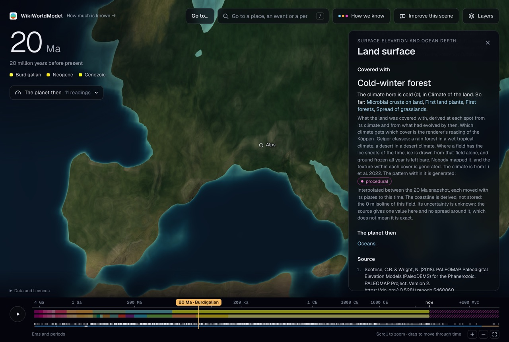
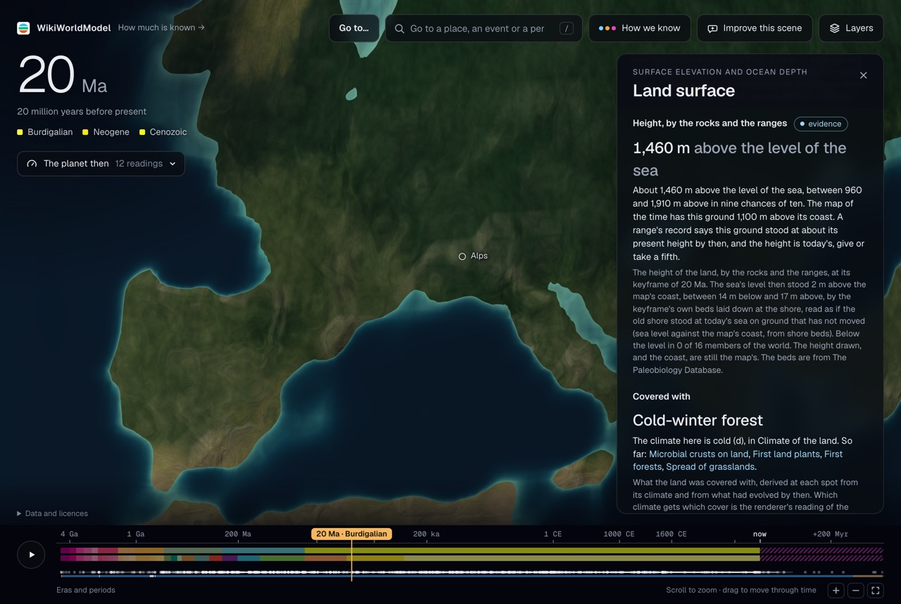
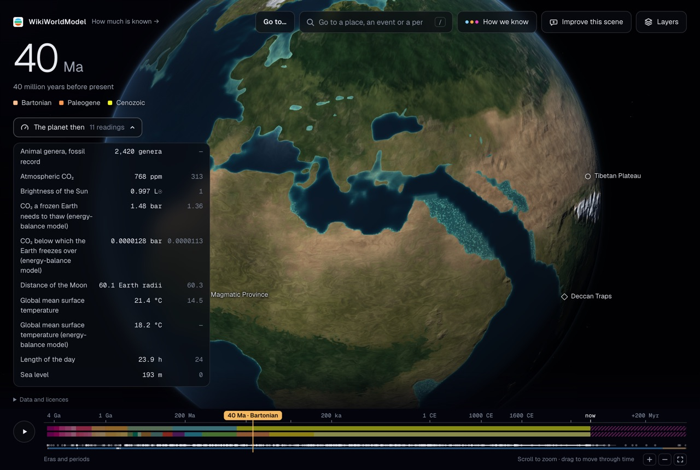
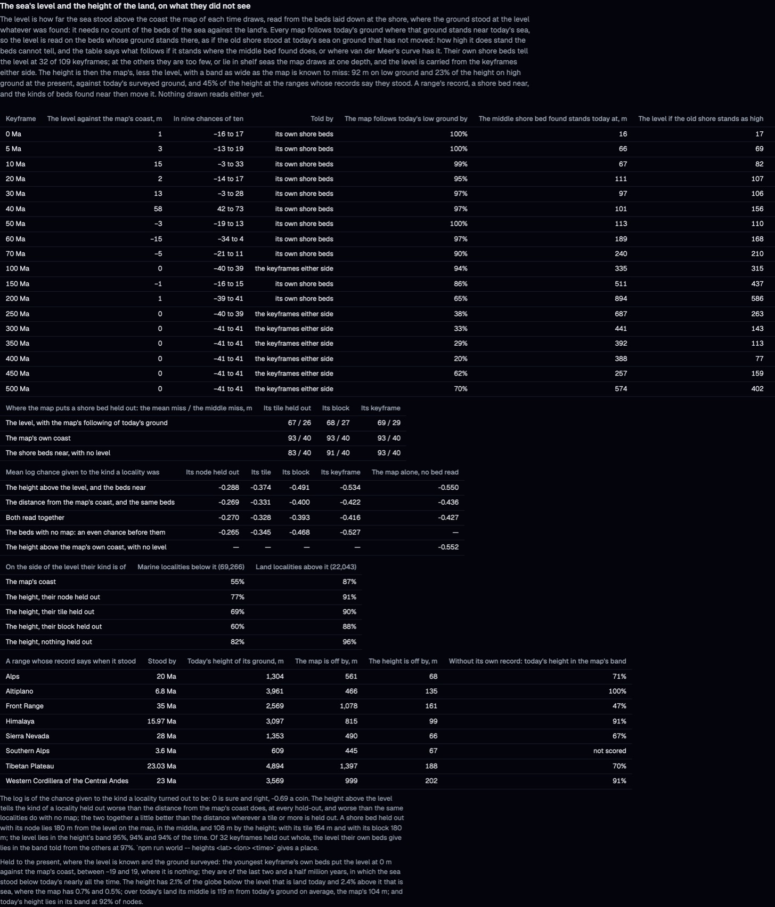

# Twenty-third slice: the sea's level and the height of the land

Status: built; see *How it was checked* for what was and was not run. It is the second step of the Earth's track of
[plans/MODELS.md](../plans/MODELS.md#after-the-pilot), *the sea's level as a cause* and *the elevation conditioned*,
built beside what the world draws: nothing that is drawn reads it yet.

The pass criteria below were written before the model, on 27 November 2026, after looking at what the evidence can
bear and before any of it was fitted. Eight of the twenty do not hold, or hold in part. They are kept, and say by how
much.

The ground of the deep past was one map for each five million years, drawn by hand, with no spread
(`field:earth/elevation`). The twenty-first slice made of it a chance of sea, by how far a place lies from the map's
coast. Two contradictions were left. Of the fossil localities in beds laid down under the sea, 45% lie on the map's
land. And the map has the Alps most of a kilometre low at 20 Ma, by when their record says they stood, and the
Himalaya's ground a kilometre higher at 15 Ma than today's, falling keyframe by keyframe. This slice makes two
quantities at the top of the order of causes, each with a spread and each scored on what it was not shown, beside
what is drawn. The ranges then stand where their records say. Of the marine localities, each told without its own
node, 23% lie above the sea's level: fewer, and not none.

It adds:

- **The sea's level against the map's coast** (`field:earth/shore-level`, `model:earth/shore-level`,
  [core/heights.ts](../../core/heights.ts)). At each of the elevation's 109 keyframes, how far the sea stood above or
  below the coast the map draws, with a band of nine chances in ten.
  - *It is not read from the kinds of beds.* More sea, and sea beds better kept, leave the same record: each doubling
    of how many more beds the sea leaves than the land is worth hundreds of metres of level.
  - *It is read from the beds laid down at the shore:* the collections the Paleobiology Database classes as marginal
    marine or shallow subtidal. Such a bed stood at the level whatever else was found, and the map's height where it
    puts one is the map's height for the level.
  - *On the beds whose ground stands near today's sea.* Shore beds are found only where their ground is land today,
    and on low ground every map is today's ground carried back. So a bed counts for less the higher its ground stands
    today, and what the map follows of today's height is taken out.
  - *Carried through time as a walk pulled back to the map's coast,* so that a keyframe whose own beds cannot tell a
    level has it from those either side, with a wider band.
  - *It leaves one thing open and says so:* how high the old shore stands today on ground that has not moved. The
    level is read as if it stood at today's sea. Each keyframe keeps how far its map follows today's ground, where
    the middle shore bed found stands today, and what the level would be if the old shore stood as high.
- **The height of the land, with a band** (`field:earth/land-height`, `model:earth/land-height`). At every node of
  the map's 1° grid and every keyframe, a middle height above the sea of the time and a spread.
  - *Where nothing else is known* it is the map's own height above its coast, less the level. Its spread is how far
    the map is known to miss: what its keyframe of the present misses today's surveyed ground by, grown by how much
    further it has a keyframe's shore beds from the level, and on high ground the share of their height by which it
    misses the ranges whose records say they stood.
  - *A range's record:* from when it says the range stood at about its present height, the ground in its outline is
    today's, give or take a fifth.
  - *A bed laid down at the shore:* there the ground stood at the level, so the map's miss is known, and it is carried
    to ground of like height about it.
  - *The kinds of beds found near,* of the sea and of the land, on ground the map has about as high: they turn the
    chance that the ground lay below the level, and the height is the bell cut at the level, each side weighed by that
    chance.
  - *A member of the world* is one share of every node's chances ([core/samples.ts](../../core/samples.ts)): the
    middle member's height is the middle, and a member's sea is wherever the chance of it is above the member's share.
- **Files of their own** (`heights/`): a file for each keyframe, of the map's height, the middle, the spread, the
  chance of sea and what the height rests on at each node, 0.46 MB each, which the viewer fetches when a click first
  asks; and an index with the levels, the fitted numbers and the scores.
- **Scores, on what neither was shown** (`heights/index.json`, and `heights` in `coverage.json`): shore beds held out
  by tile, block and keyframe; the kinds of localities held out by node, tile, block and keyframe, beside the
  distance from the map's coast, the two read together, and a smoother with no causes; each range with its own record
  left out; the present, where the level is known and the ground surveyed; and van der Meer's curve
  (`field:earth/sea-level`) set beside the level, which never reads it.
- **Shown:** the level is a reading of the planet beside van der Meer's; a click on the ground says its height with
  its band and what that rests on; the coverage page has a section of the scores; and a command answers for a place.

## Running it

```sh
npm run build:world                          # reads the level, fits the heights, writes heights/ and their scores (about 40 s of the build)
npm run world -- heights                     # how the two held on what they did not see
npm run world -- heights 45.9 7.4 "20 Ma"    # a place of today at a time: between Mont Blanc and Monte Rosa
npm run dev                                  # http://localhost:5173/?t=20Ma&lat=42.5&lon=6.5&d=1.6&cl=0, and click the ground
```

## Pass criteria

Each with what the build of this slice found. The tests are in
[core/heights.test.ts](../../core/heights.test.ts) (*core*), [tools/world/test/heights.test.ts](../../tools/world/test/heights.test.ts)
(*build*) and [viewer/test/e2e/heights.spec.ts](../../viewer/test/e2e/heights.spec.ts) (*browser*). A criterion that
does not hold is tested as it was found, so that a change which mends it is noticed.

| Criterion | Where it is checked | Found |
|---|---|---|
| There is a level of the sea for every keyframe of the elevation field, against the map's own coast and with a band; where the rocks cannot tell it, the build says so and the level is the map's own | build: *gives a level with a band at every keyframe, and says where the shore beds could not tell it* | Holds. 109 keyframes. Their own shore beds tell the level at 32; at the other 77 it is carried from the keyframes either side, and where none is near it is the map's coast, between 41 m below and 41 m above |
| The level is told without the yield: from the beds laid down at the shore and from nothing that counts how many beds of each kind were found | core: *reads the level off the beds laid down at the shore, where their ground stands at today's sea level, however many beds of each kind there are* | Holds |
| Held to the present, where the level is known, the youngest keyframe's own beds put it inside its band of the map's zero | build: *held to the present, where the level is known, has nothing inside its band and puts the level within a few metres of it* | Holds: 0 m, between 19 m below and 19 m above |
| The level tells where the map puts a shore bed held out better than the map's own zero does, and better than the other shore beds near it with no level, the more so the more is held out: a tile, a block, a keyframe | build: *tells where the map puts a shore bed held out better than the map's own coast does and than the shore beds near with no level, the more so the more is held out* | Holds. The mean and the middle miss, in metres: by the level 67 and 26 with a tile held out, 68 and 27 with a block, 69 and 29 with a keyframe; by the map's coast 93 and 40; by the shore beds near 83, 91 and 93, and 40 |
| Of the keyframes held out whole, the level their own beds give lies inside the band told from the others' about nine times in ten | build: *has a keyframe's own level inside the band told from the others about nine times in ten* | Holds: 31 of 32 |
| Set beside van der Meer's curve, which it never reads: both are scored on the same shore beds held out, in the keyframes where the map's ground is today's and the two levels mean the same thing | build: *is set beside van der Meer's curve, which it never reads: what the curve would make the level, and how many of the shore beds found stand below it today* | **Does not hold as written, and cannot.** Where the map's ground is today's, the curve and the level tell alike where the map puts a shore bed: the curve only moves the level by its own value. They differ in where the old shore stands today, which the beds found cannot settle. The curve is held to that instead: from 10 to 20 Ma about half the shore beds found stand below its level today (47 to 50%); from 25 to 50 Ma 57 to 63% do, and the middle bed stands at about 100 m where the curve has the sea at 150 to 210 m |
| Height above the fitted level tells the kind of a locality held out better than its distance from the map's coast does, on the same hold-outs: its node, its tile, its block and its keyframe | build: *tells the kind of a locality held out worse than the distance from the map's coast does, and the two together no worse than the distance* | **Does not hold.** The log of the chance given to the kind a locality was, on average: by the height −0.288, −0.374, −0.491 and −0.534; by the distance −0.269, −0.331, −0.400 and −0.422. From the map alone, with no bed read, −0.550 and −0.436; the level adds 0.003 to the height. The two read together give −0.270, −0.328, −0.393 and −0.416 |
| The height conditioned on the rocks beats the smoother with no causes on the kinds of localities held out with their tile, their block or their keyframe, by more the more is held out | build: *does not beat the smoother with no causes on the kinds of localities held out, where the distance from the map's coast and the two read together do* | **Does not hold.** The smoother gives −0.265, −0.345, −0.468 and −0.527: better than the height at every hold-out. The distance, and the two read together, beat it wherever a tile or more is held out, by more the more is |
| Its chances of sea mean what they say: of the localities given a chance of being marine, about that share were | the same test | **Holds with a node held out, and not beyond.** With a node: of those given 0.30, 0.35 were marine; of those given 0.51, 0.55; of those given 0.96, 0.95. With a block: of those given 0.09, 0.25 were; with a keyframe, of those given 0.11, 0.39. The map is surer of its land than it should be |
| There is a height with a band at every node of every keyframe, and it is the map's, less the level, where no bed lies near and no range's record speaks | build: *gives a height with a band at every node of every keyframe, the map's less the level where nothing else is known* | Holds. Something besides the map is read on 4% of the globe's nodes, and 1.4% change side of the level |
| Ground the rocks say was sea lies below the level and ground they say was land above it, more often than on the map: fewer than the map's 45% of marine localities lie on its land, with each locality's own node held out | build: *puts marine localities below the level and land ones above it more often than the map's coast does, at every hold-out* | Holds. With its own node held out, 23% of marine localities lie above the level, where 45% lie on the map's land; with its tile 31%, with its block 40%. Of land localities 91%, 90% and 88% lie above it, where 87% lie on the map's land |
| A shore bed held out lies nearer the level in the conditioned height than on the map, and the level is inside its band about nine times in ten | build: *puts a shore bed held out nearer the level than the map does, with the level in its band about nine times in ten* | **Holds with a node or a tile held out, not with a block.** In the middle a shore bed lies 180 m from the level on the map; by the height 108 m with its node held out, 164 m with its tile, 180 m with its block. The level is in the band 95%, 94% and 94% of the time |
| The ranges' contradictions are gone: inside each range's outline, from when its record says it stood, the conditioned height is today's within the doubt given it; the Alps do not stand a kilometre low at 20 Ma, nor the Himalaya's ground swing by a kilometre and a half between 10 and 5 Ma | build: *has the ranges at about today's height from when their records say they stood: the Alps at 20 Ma, the Himalaya at 10 and at 5 Ma* | Holds. Over the keyframes each stood, the eight ranges lie 66 to 202 m from today's height, where the map has them 445 to 1,397 m off. The Alps at 20 Ma: today 1,297 m, the map 609 m, the height 1,217 m. The Himalaya at 15, 10 and 5 Ma: the map 4,180, 3,562 and 3,196 m; the height 3,180, 3,109 and 3,074 m; today 3,100 m |
| A range held out and told from the rest: with its own record left out, today's height of its ground lies inside the band the other ranges' misses give the map, in most keyframes it stood | build: *says how each range fares with its own record left out* | **Holds for three of seven as a band of nine in ten should.** Inside the band: the Altiplano 100%, the Himalaya and the Western Cordillera 91%; the Alps 71%, the Tibetan Plateau 70%, the Sierra Nevada 67%, the Front Range 47%. The Southern Alps stood at the present's keyframe alone and are not scored |
| Held to the present, which the model does not know: today's measured height lies inside the band at about nine nodes in ten off the ice, and the conditioned coast leaves the measured one where it is | build: *held to the present, keeps today's height in its band at about nine nodes in ten, and moves the measured coast over less than a tenth of the globe* | **The first holds, the second does not.** Today's height lies in the band at 92% of nodes north of 60°S. The height has 2.1% of the globe below the level that is land today and 2.4% above it that is sea, where the map has 0.7% and 0.5%; over today's land its middle is 119 m from the surveyed ground on average, the map's 104 m |
| A member's height is one quantile of every node's, the median member's the middle; a member's sea is where its height is below the level, one sea inside another, and the same members have sea as in the chance of sea | core: *draws a member's height as one share of every node's chances, the middle member's the middle, and its sea where the chance is above its share* | **Holds but for its last clause.** The members' shares are the chance of sea's own, and a member's seas lie one inside another. But the chance here is the height's and not the chance of sea's, so a member's sea by the height is not its sea by the twenty-first slice's field ([Decisions](#decisions)) |
| Nothing drawn moves: the elevation, the coast drawn, the climate, the rivers and the scenes read what they read, and no golden image changes | the three browser groups | Holds: the globe's 122 tests, the city's 50 and the six city views ran against the build, and no golden image changed. The two tests that failed were this slice's own, at fault themselves ([How it was checked](#how-it-was-checked)) |
| The level is a series in the planet's readings beside van der Meer's; a click on the ground says its height with its band and what that rests on; the coverage page has the scores; a command answers for a place | browser: *the planet's readings have the sea's level from the shore beds beside van der Meer's curve*, *a click on the ground says its height with its band and what it rests on*, *the coverage page shows how the level and the heights held on what they did not see*; build: *answers for a place of today carried to the keyframe, in words, and keeps its scores in the coverage file* | Holds |
| Each model's record says its prior, what it observes and what it is held to, and names tests that hold it to each | `npm run validate` | Holds: 8 tests named for the level, 14 for the height |
| The fit and every score add under a minute to a full build | the build's log | Holds: about 40 s |

## What it finds

**The kinds of beds cannot tell a level.** The odds that a bed is marine change nearly threefold only every four or
five hundred metres of the map's height. A level fitted to the kinds, with the yield free, swings by hundreds of metres
from one keyframe to the next (455 m at 125 Ma, 1,021 m at 130 Ma, when first tried): it is the yield under another
name.

**The shore beds can, on one condition.** They need no yield. But they are found only on today's land, and every map
of the last 70 Myr follows today's low ground by 0.87 to 1.00 of its height. A shore bed on ground that has since risen
stands high on the map too, and says how far its ground rose. So the level is read where that does least, on ground
that still stands near the sea, and the reading takes the old shore, on unmoved ground, to stand at today's sea. If it
stands higher, the level is higher by the map's following times as much.

| Keyframe | Level, m | Band | The map follows today's low ground by | The middle shore bed stands today at | The level if the old shore stands there | van der Meer | The level if it stands where the curve has it | Shore beds standing below the curve |
|---|---|---|---|---|---|---|---|---|
| 0 Ma | 1 | −16 to 17 | 1.00 | 16 m | 17 | 0 | 1 | 0% |
| 5 Ma | 3 | −13 to 19 | 1.00 | 66 m | 69 | 24 | 27 | 35% |
| 10 Ma | 15 | −3 to 33 | 0.99 | 67 m | 82 | 57 | 71 | 47% |
| 20 Ma | 2 | −14 to 17 | 0.94 | 111 m | 107 | 109 | 104 | 50% |
| 30 Ma | 13 | −3 to 28 | 0.96 | 97 m | 106 | 152 | 159 | 60% |
| 35 Ma | 41 | 26 to 57 | 0.96 | 98 m | 136 | 177 | 211 | 62% |
| 40 Ma | 58 | 42 to 73 | 0.97 | 101 m | 156 | 193 | 246 | 62% |
| 50 Ma | −3 | −19 to 13 | 1.00 | 113 m | 110 | 209 | 206 | 63% |
| 60 Ma | −15 | −34 to 4 | 0.97 | 189 m | 168 | 197 | 176 | 51% |
| 70 Ma | −5 | −21 to 11 | 0.90 | 240 m | 210 | 189 | 165 | 45% |

- **As read, the maps' coasts are within some tens of metres of the level** in the last 70 Myr, and furthest below it
  at 35 and 40 Ma, by 41 and 58 m.
- **The maps themselves are not on today's zero.** Read off the whole map, ground that stands at today's sea stands
  15 to 84 m above the maps' own coasts from 5 to 45 Ma: their sea lies below today's on today's ground, in times
  whose shore beds are found above it.
- **The curve and the beds.** If ground has gone up as often as down, half the shore beds found should stand below
  where the old shore stands. From 10 to 20 Ma about half stand below van der Meer's level. From 25 to 50 Ma six in
  ten do, and the middle bed stands at about 100 m, half of where the curve has the sea. Either the sea stood lower
  than the curve has it, or the coastal plains that hold those beds have sunk a hundred metres and stayed dry. The
  beds do not decide.
- **Before 80 Ma the level is mostly not told.** The map draws its shelf seas at one depth, most shore beds lie in
  them at that depth, and a level read there would be the map's convention. Sixteen of the 32 keyframes told are the
  youngest sixteen, to 75 Ma; twelve are of 115 to 170 Ma; the other four are of 200 and of 255 to 265 Ma.

**The height's own sea is poor; its heights are not.** At a degree's grain the map's height says little of land and
sea: beds of the sea are found on ground the map has high, and a shelf's depth is drawn by convention. The distance
from the map's coast tells the kind of a bed better, and so does a smoother with no map at all. But where the height
is asked what it is for, it holds:

| | The map | The height, a node held out | a tile | a block |
|---|---|---|---|---|
| Marine localities below the level | 55% | 77% | 69% | 60% |
| Land localities above it | 87% | 91% | 90% | 88% |
| A shore bed's middle distance from the level | 180 m | 108 m | 164 m | 180 m |

| Range | Stood by | Today, m | The map's miss, m | The height's | In the band without its record |
|---|---|---|---|---|---|
| Alps | 20 Ma | 1,304 | 561 | 68 | 71% |
| Altiplano | 6.8 Ma | 3,961 | 466 | 135 | 100% |
| Front Range | 35 Ma | 2,569 | 1,078 | 161 | 47% |
| Himalaya | 15.97 Ma | 3,097 | 815 | 99 | 91% |
| Sierra Nevada | 28 Ma | 1,353 | 490 | 66 | 67% |
| Southern Alps | 3.6 Ma | 609 | 445 | 67 | not scored |
| Tibetan Plateau | 23.03 Ma | 4,894 | 1,397 | 188 | 70% |
| Western Cordillera of the Central Andes | 23 Ma | 3,569 | 999 | 202 | 91% |

**Through time.** The share of marine localities below the level, on the map and by the height with each locality's
own node held out:

| Stretch | Level told at | Marine below: the map | the height | Land above: the map | the height | Shore beds from the level: the map | the height |
|---|---|---|---|---|---|---|---|
| 95–0 Ma | 16 of 20 keyframes | 41% | 69% | 88% | 90% | 188 m | 69 m |
| 195–100 Ma | 12 of 20 | 43% | 75% | 91% | 92% | 161 m | 85 m |
| 295–200 Ma | 4 of 20 | 50% | 78% | 85% | 96% | 180 m | 80 m |
| 395–300 Ma | none | 74% | 73% | 77% | 89% | 180 m | 146 m |
| 425–400 Ma | none | 79% | 82% | 59% | 88% | 191 m | 159 m |
| 540–430 Ma, before the land had life | none | 82% | 94% | too few | too few | 212 m | 170 m |

**Well-known places,** asked as they are today:

| Place and time | The map, above its coast | The height | For the sea |
|---|---|---|---|
| Kansas, 85 Ma: the Niobrara chalk | −380 m | 290 m below, between 830 m below and 245 m above | 83% |
| Paris, 85 Ma: the chalk | −180 m | 335 m below, between 35 and 890 m below | 100% |
| Solnhofen, 150 Ma: the lagoons | 180 m | 20 m below, between 90 m below and 105 m above | 79% |
| London, 50 Ma: the London Clay | −20 m | at the level, between 120 m below and 120 m above | 49% |
| Wadi al-Hitan in the Fayum, 40 Ma: the whales' sea | 220 m | 55 m below, between 0 and 170 m below | 95% |
| Vienna, 15 Ma: the Paratethys | 260 m | 5 m below, between 140 m below and 150 m above | 52% |
| Cincinnati, 450 Ma: the limestones | −380 m | 70 m below, between 15 and 130 m below | 100% |
| Field, 505 Ma: the Burgess Shale | −180 m | 155 m below, between 320 m below and 30 m above | 89% |
| Hell Creek, 65 Ma | 140 m | 160 m above, between 20 and 335 m above | 1% |
| Moab, 150 Ma: the Morrison | 1,620 m | 1,630 m above, between 495 and 2,840 m above | 0% |
| Beaufort West, 255 Ma: the Karoo | 980 m | 990 m above, between 300 and 1,720 m above | 0% |
| Between Mont Blanc and Monte Rosa, 20 Ma | 1,100 m | 1,460 m above, between 960 and 1,910 m above | 2% |
| Everest, 10 Ma | 6,280 m | 3,610 m above, between 2,370 and 4,730 m above | 2% |
| Lhasa, 20 Ma | 7,180 m | 4,850 m above, between 3,200 and 6,340 m above | 2% |
| The Amazon at Manaus, 15 Ma | 60 m | 60 m above, between 220 m below and 335 m above | 36% |

Two are wrong or weak. London at 50 Ma lay under the sea of the London Clay, and has an even chance: beds of both
kinds lie near. Where nothing is known, as at Manaus, the band crosses the level and 36% of the chances are sea: on
low ground the map's own miss is as large as its height. And the map's Everest stands far above today's ground about
it; the height brings its node to the range's ground of today at a degree's grain, which is not a summit's.

## What it looks like

A click on the ground between Mont Blanc and Monte Rosa at 20 Ma, and the planet's readings at 40 Ma, as before this
slice and with it, in the same views on the GPU, against the same build. Nothing on the globe differs: the panel has a
section more, and the readings a row more.

| | Before | After |
|---|---|---|
| A click at 20 Ma |  |  |
| The planet's readings at 40 Ma |  |  |

The coverage page's section:



## Decisions

- **The level is not read from the kinds of beds, though the last slice named that as next.** A higher sea and a
  greater yield leave the same record. The shore beds need no yield.
- **Which beds are the shore's** is the database's own classing: marginal marine and shallow subtidal. Reefs are left
  out, since the class takes in those of the slope and of the ocean's islands. A bed over the ocean's floor is of an
  island the map does not draw, and is left out.
- **The level is read where the ground stands near today's sea,** each bed counting for 0.37 of itself with every
  150 m its ground stands above it, at the map's grain. One line through every shore bed alike read the level tens of
  metres too high: far up, the maps follow today's ground by less. How far a map follows is measured over all of
  today's low ground, and no bed enters into it.
- **What the beds cannot tell is left open and written down,** not filled: how high the old shore stands today. The
  band is of the reading. It holds none of that.
- **van der Meer's curve is set beside the level and never read by it.** It is another's reconstruction
  ([decision 13](../plans/MODELS.md)). It could not be scored against the level as the criterion asked, and is held to
  where the shore beds stand today.
- **Between keyframes the level is a walk pulled back to the map's coast.** That is smoothing, and no cause: neither
  the ice nor the room of the ocean's basins is in the world for the deep past. Its two numbers are those with which
  each keyframe's own level is best told from the others'.
- **A spread is as wide as holds nine misses in ten.** The map's misses have long tails. Spreads taken from the middle
  miss were far too narrow: the band then held today's height at 56% of nodes.
- **The present is measured north of 60°S.** The map's keyframe of the present has the rock under Antarctica's ice,
  and the survey the ice's top.
- **A range gives way to its record where the map is far from it.** Averaged as two bells, a map that has a plateau
  low kept it low, since its spread is a share of its own height. Where the map is further from the record than its
  spread, it is taken to be in one of its long misses.
- **A range's ground is carried from today's on today's plates,** not found by the plate a node of the past lies on:
  near a collision those differ, and Lhasa at 20 Ma had no range.
- **A bed's word is carried to ground of like height on the map.** The shore beds of the Molasse basin lowered the
  Alps beside them; the beds of the sea at the foot of high ground put that ground under the sea. A range that stood
  reads no kinds of beds at all.
- **The yield is the record's, not the height's.** Fitted with the height alone it came out half as great again to
  twice as great, and London at 50 Ma and Vienna at 15 Ma were told as land. The yield used is the one fitted with
  the height and the distance read together, which tell the kinds best. Each build keeps the other beside it.
- **The height's own chance is the bell's, though the distance tells sea from land better.** Read with the distance,
  the middle height of ground of which nothing is known was no longer the map's: the Amazon's rose from 58 to 130 m.
  The distance and the two together are scored as rivals. What is drawn one day should take its land and sea from the
  chance of sea, and its height on either side from here.
- **What is found near counts against the map only so far as it comes to a bed.** The map's word is fitted to count
  for a quarter of a bed, and a fifth of one stray bed's weight had a plateau the map has 2.4 km up under the sea.
- **Two choices were made after the present was looked at,** and the present no longer tests them: the like height
  for the kinds of beds, and the least a trace counts against. Before them the middle height was 167 m from today's
  surveyed land, with the first 131 m, with both 119 m, where the map's own is 104 m. The share of nodes in the band
  was 91% before and 92% after. They cost the height a little on the kinds of beds held out (−0.275, −0.349 and
  −0.476 before, with a node, a tile and a block).
- **A member is one share of every node's chances,** the simplest thing that could be so: every place too high or too
  low together.
- **The level's series is kept with the heights,** and the viewer sets it among the planet's readings. It is not in
  the build's file of series, which is made before the elevation is read.
- **Nothing drawn is switched.** The globe, the coast, the climate, the rivers, the atlases and the scenes read the
  elevation as they did.

## Limitations

- **The level is a reading with a premise:** the old shore at today's sea on unmoved ground. Against today's ground it
  could stand a hundred metres higher and the beds would look the same.
- **No level is told at 77 of 109 keyframes,** all of them older than 75 Ma: there the map's shelf seas are of one
  depth, or the shore beds too few.
- **The heights' sea is worse than the chance of sea's,** and worse than a smoother's. They are not a coast.
- **At the present the heights are worse than the map,** which is today's ground: a keyframe's beds are of two and a
  half million years, in which the sea came and went and fast ground rose a kilometre, and a bed of the sea is found
  only where the sea has since left.
- **A bell cannot hold a plateau the map has missing.** Told without its record, the Front Range lies in the band less
  than half the time. Eight ranges have records, all of the last 35 Myr: before that high ground has the map's height
  and a spread from those eight.
- **A degree's grain.** A node's height is its cell's, and a bed's is its own tenth of a degree's: a bed of the present
  misses its own node by 317 m in nine cases of ten. Everest's node is 3,600 m.
- **A moment anywhere in five million years.** The beds of a keyframe are of its whole span.
- **No cause is in it:** no uplift, no wearing down, no time before or after a keyframe. A height does not know what
  it was five million years earlier.
- **One share for the whole globe** takes every place to be high or low together. Nothing here says how far apart two
  places' misses run together.
- **The click reads the nearest node,** and says so by its keyframe; the heights are not drawn.
- **It is not a layer that answers everywhere** ([core/resolve.ts](../../core/resolve.ts)): nothing asks it at a place
  and a time but the click and the command, and the coverage page counts it in no tier.

## How it was checked

By the agent that built it (Claude Code), on one machine, on 27 November 2026:

- `npm run typecheck`;
- `npm test`, 1,184 tests passing;
- `npm run validate`, no errors and no warnings;
- a world build from the working tree, not a clean commit (`4fa2c82b449831c6`), and `npm run test:build` on it, 152
  tests passing. One comment in the build stage was corrected after it, which changes no number;
- `npm run build:viewer`, and the browser tests in software, as CI draws them, on a port of their own, once, against
  that build. The globe group: 122 tests, 120 passing. The two that failed were this slice's own, and the fault was in
  the tests: one held a height worked out in the browser to the same height worked out by Node, to the last bit of a
  float; the other looked for nine nodes of the Alps together, where the range is a node or two wide. Both were
  corrected, and the slice's five browser tests run again, passing. The city group's 50 tests and the six city views
  passed. No golden image changed;
- `npm run causes -- --check`: the graph of causes checked. Its published page was not rebuilt;
- a click on the Alps at 20 Ma and the planet's readings at 40 Ma, on the GPU, beside the same views of the viewer as
  it was before this slice, against the same build; clicks in Kansas at 85 Ma and at Cincinnati at 450 Ma; and the
  coverage page's section;
- the model asked about fifteen well-known places, its scores set out by stretch of time, and the model held to the
  present, each before the hold-outs were looked at closely. That is how most of its faults were found, which the
  scores on beds held out had not shown: spreads far too narrow, the shore beds of a basin lowering the range
  beside it, a plateau the map has low that would not rise, a level 20 m low at the present, London and Vienna told as
  land, and a plateau in Mongolia under the sea for a fifth of one bed ([Decisions](#decisions)).

Not run: `npm run test:reproducible`. Nothing was pushed, so no CI has run on it.

Some figures here are not in the build's files. They were worked out for this document with scripts, from the build
stage's own output and the build's files: the level a fit to the kinds of beds gave, the heights of well-known
places, what the present gave before each of the two late choices, and the kinds' scores before them.

No source was read and no claim was written. The slice adds two fields and two models, which read datasets and
records the world already had, so no quote was checked.

## Next

On the Earth's track of [plans/MODELS.md](../plans/MODELS.md#after-the-pilot):

- **Draw from both.** Land and sea from the chance of sea, the height on either side from here, as one field with
  members that the climate and the rivers can stand on. Then the coast drawn can move.
- **How high the old shore stands today.** The one thing the level leaves open. It wants a cause: the ice's volume
  from the isotopes, the room of the basins from the age of the ocean's floor, or the ground's own rise and fall
  under each bed.
- **A level before 80 Ma.** The shelf seas' depths are the map's convention there. The columns of rock, with their
  shore beds bed by bed, may tell what the collections cannot.
- **Heights with a cause:** a range's rise from when its plates met, and its wearing down after, so that a height
  knows the keyframe before it and a plateau the map has missing can be told without its own record.
- **How misses run together:** members that are not one share for the whole globe.
- **More ranges' records,** and older ones: the Appalachians, the Variscan ranges, the Urals.
